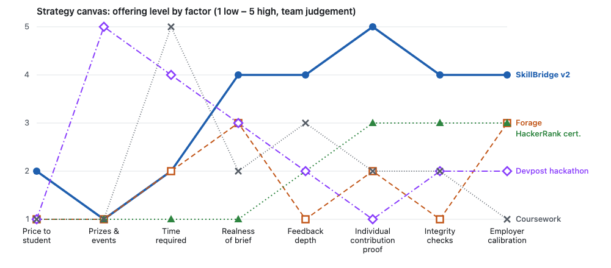

# Value curve (strategy canvas), v2

**2026-10-12.** Offering level from 1 (low) to 5 (high) on the factors the
challenge and assessment market competes on. **Scores are team judgement** from
published offers and the [deep research notes][N]; they are not measured. The
moves behind SkillBridge's curve are in the [ERRC grid](../ERRC.md).

Source chart: [value-curve.svg](value-curve.svg). Kaggle and NUWE are discussed
below but left off the chart to keep it readable.

## Scores and reasons

| Factor | SkillBridge v2 | Forage | HackerRank cert. | Devpost hackathon | Coursework |
|---|---|---|---|---|---|
| Price to student | 2: €15 optional certified result (test price) | 1: free | 1: free certifications | 1: student hackathons free | 1: no extra cost |
| Prizes and events | 1: **eliminated** | 1: none | 1: none | 5: prize pools, 24–48 h events | 1: none |
| Time required | 2: 2–7 h | 2: 2–6 h | 1: short timed test | 4: 24–48 h | 5: weeks or a semester |
| Realness of brief | 4: real company brief | 3: employer-designed simulation | 1: standard puzzles | 3: sponsor themes or APIs | 2: academic exercise |
| Feedback depth | 4: rubric breakdown and engineer's written feedback (**raised**) | 1: compare with a model answer | 2: a score | 2: judged for prizes | 3: grade and some comments |
| Individual contribution proof | 5: commits plus peer ratings plus debrief (**created**) | 2: solo but unverified | 3: solo, proctored | 1: team result | 2: often peer-graded |
| Integrity checks | 4: live debrief for top results (**raised**) | 1: none published | 3: proctoring, but AI cheating rising | 2: judges see a demo | 2: varies |
| Employer calibration | 4: rubric signed off by the company (**created**, credibility untested) | 3: employer brand on the certificate | 3: tests built on recruiting data | 2: sponsor judging | 1: none |

## Reading the curve

- **Divergence:** SkillBridge drops prizes and events and stays low on time and
  price, then rises on proof of contribution, integrity, feedback and employer
  calibration, the factors where every alternative is weak. That is the
  value-innovation shape in the [ERRC](../ERRC.md).
- **Where we lose:** price. Every alternative is free to students; this is the
  riskiest part of the curve ([assumptions](../assumptions.md#riskiest-assumption)).
- **Off-chart alternatives:** Kaggle (free, data science only, leaderboard rank,
  weeks of work); NUWE (Barcelona, company challenges for CaixaBank, Oracle and
  Schneider Electric; €739k raised), the closest local competitor, whose student
  pricing and contribution model are not published ([market landscape][N-m]).

## So what

The curve is only as good as two untested claims: that recruiters value the
calibrated, attributed score (Arm B) and that students pay for it (Arm A) in the
[experiment card](../experiment-card.md). If either fails, the "Employer
calibration" and "Price" points move first.

[N]: deep-research/research_notes/SkillBridge%20v2%20challenge%20market/
[N-m]: deep-research/research_notes/SkillBridge%20v2%20challenge%20market/market_landscape.md
